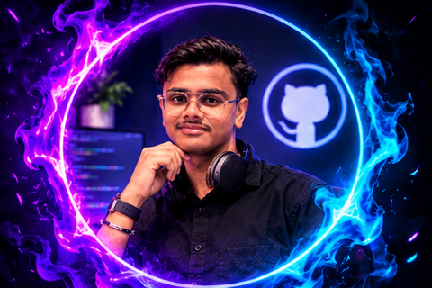
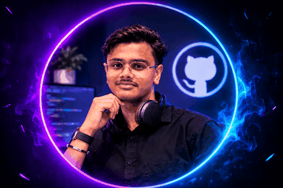

<div align="center">



<br/>

# <span style="color:#8B5CF6">Hey, I'm</span> <span style="color:#22D3EE">M Rakesh</span> 👋

### 💻 AI & Machine Learning Student | Future AI Engineer


<br/>

[](https://git.io/typing-svg)

</div>

---

## 🧑‍💻 About Me


- 🎓 B.Tech CSE — Artificial Intelligence & Machine Learning
- 🏫 SRM Institute of Science and Technology, Kattankulathur
- 📍 Hyderabad, India
- 🧠 Exploring Artificial Intelligence and Machine Learning
- 💻 Learning Python, C, C++ and Data Structures & Algorithms
- 🔬 Interested in building real-world intelligent systems
- 🚀 Goal: Become an AI/ML Engineer

> **I don't just want to learn technology. I want to build something meaningful with it.**

<br clear="right"/>

---

## ⚡ Tech Stack

<div align="center">

### Languages


### AI • ML • Data


### Tools & Platforms


</div>

---

## 📊 GitHub Analytics

<div align="center">


<br/>


</div>

---

## 🚀 Featured Project

<div align="center">

<a href="https://github.com/mrakesh-1811/vehicle-emissions-ml">


</a>

</div>

### 🚗 Vehicle Emissions Prediction using Machine Learning

A machine learning project exploring vehicle emissions prediction using regression algorithms.

- 🤖 Linear Regression
- 🌲 Random Forest
- ⚡ Gradient Boosting
- 📊 MAE, RMSE & R² evaluation
- 🛠️ Python, Pandas, NumPy, Scikit-learn

---

## 📈 Contribution Graph

<div align="center">


</div>

---

## 🎯 My Current Mission

```text
> Learn something new every day
> Improve my problem-solving skills
> Build real-world AI/ML projects
> Master Data Structures & Algorithms
> Turn ideas into working projects
> Become an AI Engineer
```

---

<div align="center">



### <span style="color:#22D3EE">BUILD • LEARN • CREATE • REPEAT</span>

### 🌐 Connect With Me

<a href="https://github.com/mrakesh-1811">

</a>

<a href="https://www.linkedin.com/in/rakesh-m-84463837b/">

</a>

<br/><br/>


<br/>

### <span style="color:#8B5CF6">⚡ Dream Big. Code Bigger. ⚡</span>

</div>
