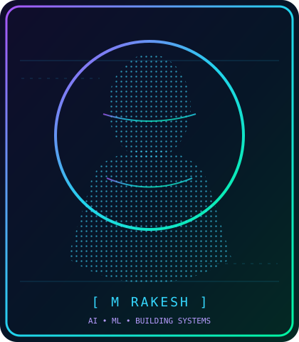

<table>
<tr>
<td width="38%" align="center">

<b>[ M RAKESH • AI & ML ]</b>

</td>
<td width="62%">

# Hi 👋
# I'm M Rakesh

<code>AI & Machine Learning Student | Aspiring AI Engineer</code>

**LOCATION** &nbsp; Hyderabad, India  
**EDUCATION** &nbsp; B.Tech CSE — AI & ML, SRM KTR  
**FOCUS** &nbsp; Python • C++ • Machine Learning • DSA  
**PORTFOLIO** &nbsp; [github.com/mrakesh-1811](https://github.com/mrakesh-1811)

### SKILLS

</td>
</tr>
</table>

---

- 👋 I'm a **B.Tech CSE (AI & ML)** student at **SRM Institute of Science and Technology, Kattankulathur (KTR)**, building my foundations in computer science, AI, and machine learning.
- 🛠️ I enjoy **building, debugging, and understanding how things work** rather than just memorizing theory.
- 📚 Currently learning **Python, Data Structures & Algorithms, and the math behind Machine Learning**.
- 🎯 Working toward a career in **AI/ML engineering** and intelligent systems.

---

## 📊 GitHub Stats

 

---

## 🐍 Contribution Graph

---

## 🚀 Featured Project

### 🚗 Vehicle Emissions ML
Machine-learning project comparing regression models to predict vehicle CO₂ emissions from vehicle features.

- **Models:** Linear Regression • Random Forest • Gradient Boosting
- **Metrics:** MAE • RMSE • R²
- **Tools:** Python • Pandas • NumPy • Scikit-learn
- **Dataset note:** Current sample rows are synthetic and for practice/testing only.

---

### `BUILD • LEARN • GROW`

Keep coding. Keep improving. 🚀

