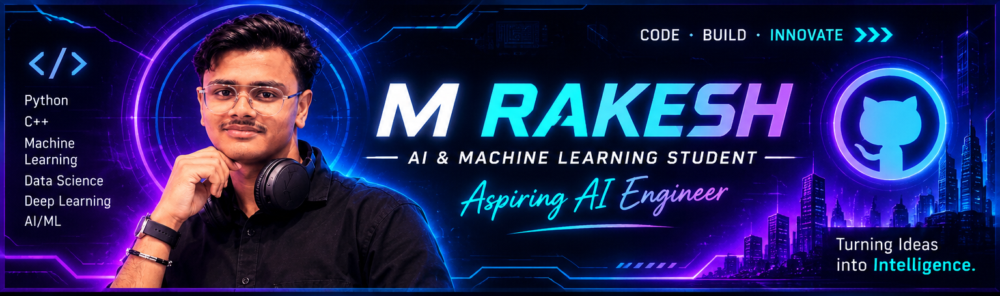

<div align="center">

<!-- ================= BANNER ================= -->



<br/>

<!-- ================= SCANNER ================= -->


<br/>

# ⚡ Hey, I'm <span style="color:#22D3EE">Mekapati Rakesh</span>

### 💻 AI & Machine Learning Student | Aspiring AI Engineer

[](https://git.io/typing-svg)

<br/>


</div>

---

<!-- ================= ABOUT ME ================= -->

## 👨‍💻 About Me


- 🎓 B.Tech CSE — Artificial Intelligence & Machine Learning
- 🏫 SRM Institute of Science and Technology, Kattankulathur
- 📍 Hyderabad, India
- 🧠 Exploring Artificial Intelligence and Machine Learning
- 💻 Learning Python, C, C++ and Data Structures & Algorithms
- 🔬 Interested in building real-world intelligent systems
- 🚀 Goal: Become an AI/ML Engineer

> *Dream big. Learn deeply. Build things that matter.*

<br clear="right"/>

---

<!-- ================= TECH STACK ================= -->

## ⚡ Tech Stack

<div align="center">

### 💻 Programming Languages


### 🧠 AI • ML • Data


### 🛠️ Tools & Platforms


</div>

---

<!-- ================= PROJECT ================= -->

## 🚀 Featured Project

<div align="center">

<a href="https://github.com/mrakesh-1811/vehicle-emissions-ml">


</a>

</div>

### 🚗 Vehicle Emissions Prediction using Machine Learning

A machine-learning project exploring vehicle emissions prediction using regression models.

- 🤖 Linear Regression
- 🌲 Random Forest
- ⚡ Gradient Boosting
- 📊 MAE, RMSE & R² evaluation
- 🛠️ Python, Pandas, NumPy, Scikit-learn

---

<!-- ================= GITHUB STATS ================= -->

## 📊 GitHub Analytics

<div align="center">


<br/><br/>


</div>

---

<!-- ================= CONTRIBUTIONS ================= -->

## 📈 Contribution Activity

<div align="center">


</div>

---

<!-- ================= MISSION ================= -->

## 🎯 My Mission

```text
[01] Learn AI & Machine Learning
[02] Master Data Structures & Algorithms
[03] Build projects that solve real problems
[04] Improve every day
[05] Become an AI Engineer
```

---

<!-- ================= CONNECT ================= -->

<div align="center">

## 🌐 Connect With Me

<a href="https://github.com/mrakesh-1811">

</a>

<a href="https://www.linkedin.com/in/rakesh-m-84463837b/">

</a>

<br/><br/>


<p align="center">
  
</p>

<p align="center">
  
</p>

<p align="center">
  
</p>
<br/><br/>

# ⚡ CODE • BUILD • INNOVATE ⚡

### <i>Turning ideas into intelligence.</i>

<br/>

<!-- ================= FOOTER SCANNER ================= -->


<br/>

<code>SCAN COMPLETE • HUMAN × AI • SYSTEM ONLINE</code>

</div>
