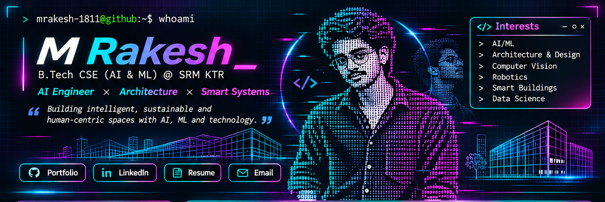
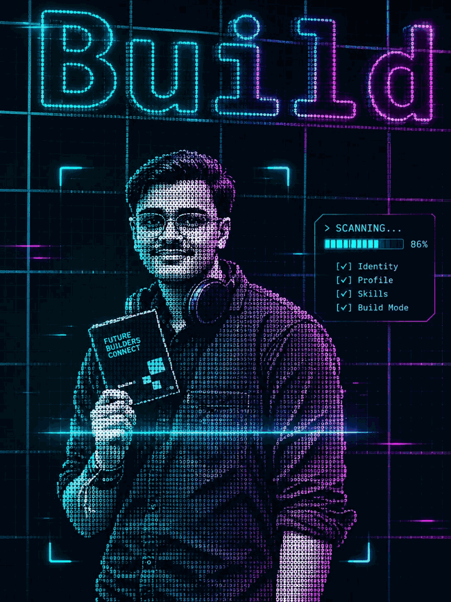

<!-- ================= NEON HEADER ================= -->
⚡ M RAKESH
AI & ML Student | Aspiring AI Engineer | AI × Architecture

<code>ARTIFICIAL INTELLIGENCE × HUMAN CREATIVITY</code>

<!-- ================= ABOUT ME ================= -->⚡ 01 — About Me
Name: Mekapati Rakesh
Education: B.Tech CSE (AI & ML)
University: SRM IST, Kattankulathur
Graduation: 2029
Location: India
Career Goal: AI & ML Engineer
Special Interest: AI × Architecture
Focus: Applied Machine Learning
Current Status: Learning and Building
I am a Computer Science undergraduate specializing in Artificial Intelligence and Machine Learning at SRM Institute of Science and Technology, Kattankulathur.

I am passionate about artificial intelligence, computational problem-solving, robotics, architecture and intelligent systems.

My interests include integrating machine learning with architectural design, spatial computing and smart infrastructure to create sustainable, intelligent and human-centric environments.

I believe in learning through practical implementation, experimentation and continuous improvement.
Building intelligent solutions for a smarter world.

<!-- ================= FEATURED PROJECTS ================= -->🚀 02 — Featured Projects
🏢 AI Smart Building Energy Optimizer | V2.0

An AI-powered building energy management prototype combining machine learning, interactive 3D digital twins, HVAC scenario analysis and sustainable infrastructure.
<h3>⚡ Smart Building AI — Project Evolution</h3>
<h4>V1.0 — Machine Learning Energy Optimizer</h4>

<h4>V2.0 — AI Digital Twin &amp; Energy Analytics</h4>

Technical Features
- Interactive five-floor 3D building digital twin.
- Machine learning-based energy demand forecasting.
- HVAC setpoint scenario optimization.
- Hourly occupancy heatmaps.
- Electricity cost and carbon emission analytics.
- Three regression models with validation-based selection.
- User-provided CSV dataset integration.
- Downloadable PDF and CSV simulation reports.
- Automated testing and GitHub Actions configuration.
- Streamlit Cloud deployment.
Technical Achievements
Metric	Result
Synthetic dataset	8,760 hourly records
ML models compared	3
Selected algorithm	Gradient Boosting
Test R² Score	0.9886
Test MAE	1.3230 kWh
Test RMSE	1.6632 kWh
Baseline daily energy	1,291.02 kWh
Optimized daily energy	1,087.29 kWh
Predicted energy savings	15.78%
Estimated daily cost savings	INR 1,629.86
Estimated avoided emissions	142.61 kg CO2e
Automated local tests	7/7 Passed
Deployment	Streamlit Cloud

  

<b>📊 View Model Comparison</b>

Model	MAE	RMSE	R²
Linear Regression	1.5696	2.1485	0.9809
Random Forest	1.3564	1.6953	0.9881
Gradient Boosting	1.3230	1.6632	0.9886

Technologies

Research prototype using synthetic data. Energy savings, cost reductions and carbon estimates are simulated, not measured real-world outcomes. No live sensors or physical HVAC control.

🚗 Vehicle Emissions Prediction — Machine Learning
An applied machine learning project exploring vehicle emissions prediction using regression techniques.

Technical Focus
- Data preprocessing and exploratory data analysis
- Regression-based prediction
- Environmental machine learning
- Model development and evaluation
Technologies

Status: Project repository available
🧠 Interactive Algorithm Lab
A browser-based educational platform exploring artificial intelligence, computational logic and interactive algorithm visualization.

Technical Focus
- Computational problem-solving
- Interactive algorithm demonstrations
- Browser-based visualization
- Spatial navigation concepts
Technologies
🤖 Autonomous Line Follower Robot
An Arduino-based robotics prototype exploring autonomous navigation through IR sensor feedback and motor control.

Technical Focus
- IR sensor integration
- L298N motor driver control
- Sensor-based decision-making
- Direction correction
- Embedded navigation logic
Technologies

Status: Prototype development

<!-- ================= ALGORITHM LAB ================= -->🧩 03 — Interactive Algorithm Lab

An interactive learning environment for exploring algorithms, artificial intelligence and architectural spatial computing.
Algorithm Exploration
Interactive Module	Technical Concept
🎮 AI Tic Tac Toe	Minimax Algorithm
🧭 Maze Pathfinder	BFS, DFS and A*
🧩 Sudoku Solver	Recursive Backtracking
🔐 Binary Decoder	Binary Encoding
🏛️ Architectural Navigation	Spatial Pathfinding
🧠 Neural Network Visualizer	Forward Propagation

The table describes the lab's intended learning scope. See the live application and source code for currently available implementations.

<code>EXPLORE • COMPUTE • SOLVE • INNOVATE</code>

<!-- ================= TECH STACK ================= -->💻 04 — Tech Stack & Skills

Programming Languages
Machine Learning & Data Analysis

Deep Learning & Computer Vision — Learning
Development & Prototyping

Web Development
Application Deployment

Backend & Deployment — Learning Goals
Architecture & Design — Exploration

<!-- ================= ENGINEERING INTERESTS ================= -->🏛️ 05 — Engineering Interests
My primary interest is exploring the intersection of artificial intelligence and the built environment.
Domain	Area of Interest
Artificial Intelligence	Intelligent decision-making systems
Machine Learning	Predictive modeling and applied AI
Deep Learning	Neural networks and pattern recognition
Computer Vision	Visual perception and floor plan analysis
Architecture	Computational and generative design
Spatial Computing	Indoor navigation and space optimization
Sustainability	Energy-efficient intelligent buildings
Robotics	Autonomous navigation and embedded systems
Digital Twins	Intelligent virtual building representations
BIM	Building Information Modeling

<!-- ================= CURRENT FOCUS ================= -->🎯 06 — Current Focus
- Strengthening Python and C++ programming
- Mastering Data Structures and Algorithms
- Developing practical machine learning applications
- Learning model evaluation and deployment
- Exploring deep learning and computer vision
- Developing robotics and embedded systems knowledge
- Integrating AI with architectural design
- Exploring BIM and computational design
- Learning smart building and space management systems
- Preparing for engineering internships and technical collaboration
<!-- ================= GITHUB ANALYTICS ================= -->📊 07 — GitHub Analytics

<!-- ================= CONTRIBUTION ACTIVITY ================= -->📈 08 — Contribution Activity

<code>CONSISTENCY × CURIOSITY × CONTINUOUS IMPROVEMENT</code>

<!-- ================= CONNECT ================= -->🤝 09 — Connect With Me
I am open to learning, technical collaboration, research-oriented projects and internship opportunities in Artificial Intelligence and Machine Learning.

Open to learning, collaboration and internship opportunities.

<!-- ================= NEON SCANNING ANIMATION ================= -->
<picture>
  <source media="(prefers-reduced-motion: reduce)" srcset="./assets/build-neon.png"/>
  
</picture>
<!-- ================= NEON FOOTER ================= -->

<code>BUILD · LEARN · ENGINEER</code>

<code>HUMAN × AI | SYSTEM ONLINE</code>

