# Rakesh AI Scan Portrait

Animated symbol portrait with a cyan scan beam, neon border, blinking HUD text and floating scan particles.


## Files
- `scan-avatar.svg` — animated SVG overlay
- `assets/avatar-symbols.png` — symbol-art portrait source image

## GitHub profile use
Upload both `scan-avatar.svg` and the `assets/avatar-symbols.png` file to your profile repository, preserving the folder structure. Add this to `README.md`:


```html
<div align="center">
  
</div>
```

Note: GitHub README rendering may sanitize or disable SVG animation. If the scan doesn't animate on your profile, convert this design to GIF for reliable looping.
